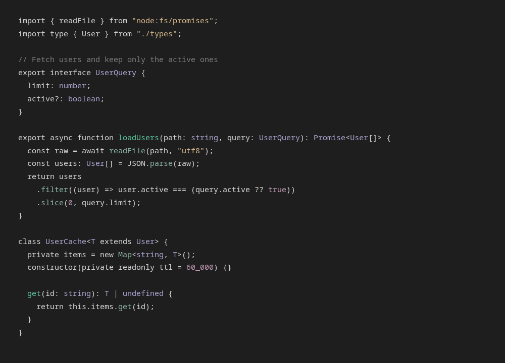
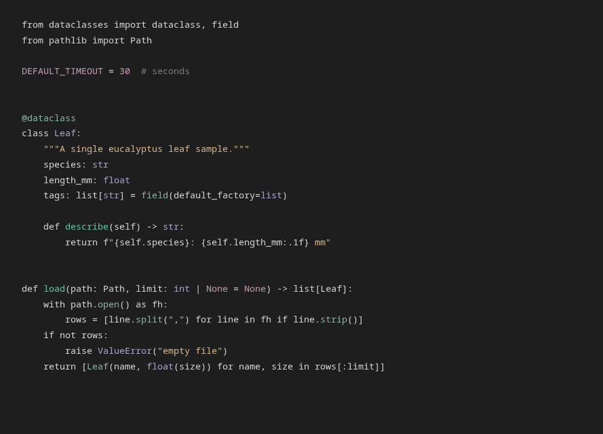

# Minty

A calm, minimal dark theme for VS Code built around eucalyptus green.

Most code stays off-white, in the spirit of the JetBrains dark themes. Color shows up only where it carries meaning: eucalyptus marks where functions are defined, a dustier green marks where they are used, and a few soft accents pick out types, strings and numbers. The background is a pure charcoal grey with no blue tint.





## Palette

| Role | Color |
|---|---|
| Background | `#1E1E1E` |
| Variables, properties, keywords, operators | `#D4D6D5` off-white |
| Function declarations, Markdown headings, UI accents | `#5FC9A0` eucalyptus |
| Function calls, decorators, JSON/YAML keys, HTML attributes, CSS selectors | `#8DB5A5` dusty eucalyptus |
| Types, classes, interfaces | `#ADA4D0` lavender |
| Strings | `#D7B98E` sand |
| Numbers, constants, booleans | `#C29BB8` mauve |
| Comments | `#7A7E7C` grey |
| Selection, bracket match, find matches | `#5F8575` deep eucalyptus |
| Errors / warnings | `#E07A6F` coral / `#D9A85B` amber |

Every text color meets WCAG AA contrast (4.5:1) against the background. Comments sit at about 4:1 on purpose, so they recede.

There is no bold or italic except in Markdown. Unused code fades to 50% opacity, and deprecated symbols get a strikethrough.

Tuned for TypeScript/JavaScript (including JSX), Python, JSON, YAML, CSS, HTML and Markdown. Semantic highlighting is on.

## Install

From a packaged `.vsix`:

```sh
npm run package
code --install-extension minty-0.1.0.vsix
```

Then pick **Minty** with `Preferences: Color Theme` (Ctrl+K Ctrl+T).

## Develop

All colors live in [`src/palette.mjs`](src/palette.mjs). The theme JSON in `themes/` is generated from it.

```sh
npm run build   # checks contrast, then writes themes/minty-color-theme.json
npm run check   # contrast check only
```

To see changes live, open this folder in VS Code and press F5. That starts an Extension Development Host with the theme loaded. After `npm run build`, the host picks up the new colors.

`preview/index.html` is a browser preview with a palette tuner, used to pick the colors.

To add a variant, add an entry to `variants` in `src/palette.mjs` and a matching entry under `contributes.themes` in `package.json`.

## License

MIT
